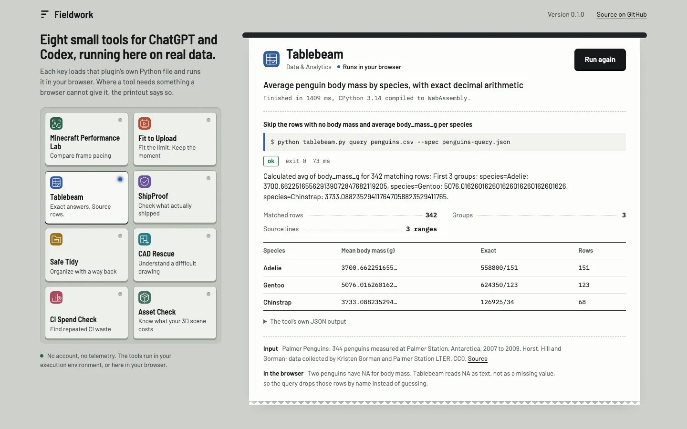

# Fieldwork plugins

Eight small plugins for ChatGPT and Codex. Each one is a single-file Python CLI behind a
`SKILL.md`, so the agent runs a command you can read instead of improvising.

[](https://fieldwork-plugins.vercel.app)

## Try it

Open **https://fieldwork-plugins.vercel.app** and press a key. The page runs that plugin's
own script in Pyodide on public data. Install one in Codex with these two commands.

```sh
codex plugin marketplace add fortunexbt/fieldwork-plugins
codex plugin add tablebeam@fieldwork
```

## The plugins

- [Minecraft Performance Lab](plugins/frame-lab) compares frame captures and reports frame-time tails and 1% lows.
- [Fit to Upload](plugins/fit-to-upload) encodes a video to fit a size cap with FFmpeg and verifies the result.
- [Tablebeam](plugins/tablebeam) answers CSV questions with exact decimal arithmetic and shows the source rows.
- [ShipProof](plugins/shipproof) checks a live URL against the assets you meant to ship.
- [Safe Tidy](plugins/safe-tidy) finds duplicate files and plans a reorganisation you can undo. It doesn't delete anything.
- [CAD Rescue](plugins/cad-rescue) previews DXF, SVG and (with LibreDWG) DWG drawings and recovers a validated DXF copy.
- [CI Spend Check](plugins/ci-spend-check) ranks GitHub Actions workflows by repeated failures and duration.
- [Asset Check](plugins/asset-check) checks glTF and GLB exports against triangle and byte budgets.

## Run locally

Python 3.11 or later. Fit to Upload and its tests need `ffmpeg`, the CAD preview tests use
`rsvg-convert`, and the ShipProof demo needs network access.

```sh
python3 -m venv .venv && . .venv/bin/activate
pip install -r requirements-dev.txt -r plugins/cad-rescue/skills/cad-rescue/requirements.txt
python -m unittest discover -s tests
python scripts/run_demos.py     # each site demo, against the real tool
python scripts/build_site.py    # the site, into .artifacts/site
```

## What is simulated

The tools run unmodified, with three substitutions in `site/run/`. The browser has no hard
links, so Safe Tidy's demo stops at the plan. ShipProof's request goes through
`XMLHttpRequest`, and the fetch and hash are real. Fit to Upload replays FFmpeg output
recorded from the committed clip and computes the byte budget live.

Each command prints JSON and refuses to overwrite a file. CI runs the tests on Python 3.11
and 3.13 and fails if a value the site shows is missing from the tool's real result.

## Demo inputs

| Plugin | Input | Source and licence |
| --- | --- | --- |
| Minecraft Performance Lab | Capture `mmc-r12-112954-0`, Minecraft 26.3 | [minecraft-apple-silicon-framework](https://github.com/fortunexbt/minecraft-apple-silicon-framework), MIT. It has no `route.json`, so the tool measures it but won't rank it. |
| Fit to Upload | 2:00 to 2:05 of Big Buck Bunny, 320x180 | (c) Blender Foundation, [CC BY 3.0](https://peach.blender.org/about/) |
| Tablebeam | `penguins.csv`, 344 rows | [Palmer Penguins](https://github.com/allisonhorst/palmerpenguins), Horst, Hill and Gorman, CC0 |
| ShipProof | `pyodide.mjs` from `pyodide@314.0.7` on npm and jsDelivr | [Pyodide](https://github.com/pyodide/pyodide), MPL-2.0 |
| Safe Tidy | The 12 files of capture session `mmc-r12-112954` | Same repository as the Frame Lab capture, MIT |
| CAD Rescue | `usa.dxf`, 59 polylines | [ezdxf examples](https://github.com/mozman/ezdxf/tree/master/examples/addons/drawing/data), MIT |
| CI Spend Check | 51 Actions runs of [fortunexbt/barter](https://github.com/fortunexbt/barter/actions), saved 2026-10-23 | Public GitHub API data, MIT repository |
| Asset Check | The Fox model | [Khronos glTF-Sample-Assets](https://github.com/KhronosGroup/glTF-Sample-Assets/tree/main/Models/Fox), model PixelMannen (CC0), rigging tomkranis (CC BY 4.0), conversion AsoboStudio and scurest (CC BY 4.0) |

The budgets and the Tablebeam question are the only demo choices. Commits and font credits
are in [THIRD_PARTY_NOTICES.md](THIRD_PARTY_NOTICES.md).

## License

MIT, except `plugins/cad-rescue`, which is GPL-3.0-only. Submission to OpenAI's plugin
directory is waiting on developer identity verification.
