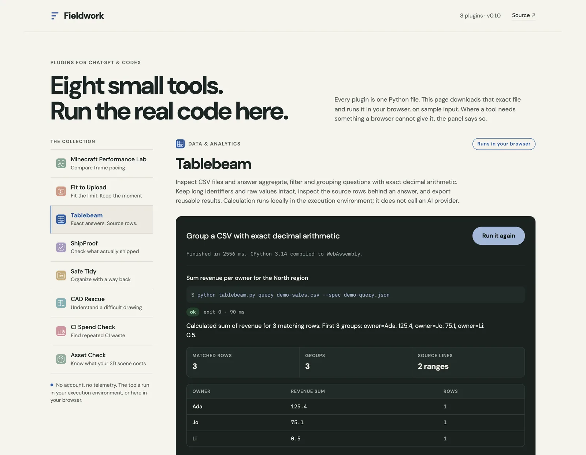

# Fieldwork plugins

**Try every tool in the browser: https://fieldwork-plugins.vercel.app**

[](https://github.com/fortunexbt/fieldwork-plugins/actions/workflows/ci.yml)
[](LICENSE)

[](https://fieldwork-plugins.vercel.app)

Eight small plugins for ChatGPT and Codex. Each one wraps a single-file Python CLI
(standard library, except CAD Rescue) behind a `SKILL.md`, so the agent runs a bounded,
inspectable command instead of improvising.

The catalog site is not a set of screenshots. It downloads the same script the plugin
ships, runs it in Pyodide on real public data, and prints whatever the tool prints.
Every input is listed with its source and licence under [Demo inputs](#demo-inputs).

| Plugin | What it does |
| --- | --- |
| [Minecraft Performance Lab](plugins/frame-lab) | Compares Minecraft frame captures, rejects incomplete runs, reports frame-time tails and true 1% lows next to the settings that produced them. Bundles the [Minecraft Frame Bench](https://github.com/fortunexbt/minecraft-frame-bench) harness. |
| [Fit to Upload](plugins/fit-to-upload) | Probes a video, plans a byte budget for a size cap, encodes a verified MP4 with FFmpeg. Originals untouched. |
| [Tablebeam](plugins/tablebeam) | Answers filter, count, sum and grouped-aggregate questions about a CSV with exact decimal arithmetic and a view of the source rows. Runs locally. |
| [ShipProof](plugins/shipproof) | Compares expected release assets and content markers with a live URL, and prepares a repository handoff with revision and working-tree evidence. |
| [Safe Tidy](plugins/safe-tidy) | Finds byte-identical files, previews a reorganization, applies it with a receipt, undoes it later. Never deletes or overwrites. |
| [CAD Rescue](plugins/cad-rescue) | Inspects DXF, SVG and DWG drawings (layers, units, extents), builds a vector preview, recovers a validated DXF copy. DWG goes through an optional LibreDWG runtime. GPL-3.0. |
| [CI Spend Check](plugins/ci-spend-check) | Ranks GitHub Actions workflows by repeated failures, cancelled work and duration, with the calculation and links behind each finding. |
| [Asset Check](plugins/asset-check) | Checks glTF/GLB exports against explicit triangle and byte budgets and reports missing resources. |

## Design rules

- Input paths are explicit. Nothing searches the home directory.
- Output files must be new; existing files are refused.
- Every command prints a JSON envelope (`status`, `summary`, `data`, `warnings`) and,
  where it writes a file, a receipt with path, size and SHA-256.
- Reports state what they do not measure. For example, Frame Lab numbers are CPU
  frame-production intervals, not GPU or display latency, and Asset Check is not a
  substitute for frame-rate measurement on target devices.

## Layout

```
plugins/<name>/
  plugin.json            portable manifest
  .codex-plugin/         Codex manifest
  skills/<name>/         SKILL.md, scripts/, and assets/ where a tool needs them
scripts/                 release tooling and the demo runner
tests/                   unit tests
samples/                 the real inputs the catalog demos run on
site/                    catalog site; site/run holds the Pyodide harness
docs/                    README screenshot
```

## In the browser

Each plugin in `catalog.json` carries a `demo` block: the input files and their credit, the
exact argv to run, and which values from the result to show. `site/run/worker.js` boots
Pyodide in a module worker, `site/run/harness.py` compiles the tool and executes it as
`__main__`, and `scripts/run_demos.py` runs the same steps with a local interpreter so CI
fails when a demo drifts from its tool.

A browser withholds three things the tools use, and the harness substitutes each one
visibly rather than faking a result:

- **Hard links.** The in-memory filesystem has none, so publishing an output file falls
  back to an exclusive create plus a byte copy. That does not share an inode, so Safe
  Tidy's `apply` correctly refuses to run there and the demo stops at the plan.
- **Sockets.** ShipProof's HTTP request goes through a blocking `XMLHttpRequest`. The
  URL, the bytes and the comparison are real: it fetches `pyodide.mjs` from jsDelivr and
  hashes it against the copy in the `pyodide@314.0.7` npm package.
- **FFmpeg.** Fit to Upload replays recorded output from real `ffprobe` and `ffmpeg` on
  the committed clip, captured by `scripts/make_samples.py`. The byte budget is
  calculated live from that metadata and the clip's real size on disk.

Everything else, including CAD Rescue's `ezdxf` parsing, runs unmodified.

## Demo inputs

| Plugin | Input | Source and licence |
| --- | --- | --- |
| Minecraft Performance Lab | Capture `mmc-r12-112954-0`: Minecraft 26.3, a 21-second scripted flight, 10,569 frame intervals | The author's [minecraft-apple-silicon-framework](https://github.com/fortunexbt/minecraft-apple-silicon-framework), MIT. Its harness writes `route.csv`, not the `route.json` Frame Lab ranks on, so the tool rejects it as a ranking input and still measures it. |
| Fit to Upload | 2:00 to 2:05 of Big Buck Bunny, 320x180, stream copy | (c) Blender Foundation, [CC BY 3.0](https://peach.blender.org/about/). FFmpeg output is a real recording. |
| Tablebeam | `penguins.csv`, 344 rows | [Palmer Penguins](https://github.com/allisonhorst/palmerpenguins), Horst, Hill and Gorman, CC0 |
| ShipProof | `pyodide.mjs` from `pyodide@314.0.7` on npm, checked against jsDelivr | [Pyodide](https://github.com/pyodide/pyodide), MPL-2.0 |
| Safe Tidy | The 12 files of capture session `mmc-r12-112954` | Same repository as the Frame Lab capture, MIT |
| CAD Rescue | `usa.dxf`, 59 polylines | [ezdxf examples](https://github.com/mozman/ezdxf/tree/master/examples/addons/drawing/data), MIT |
| CI Spend Check | All 51 Actions runs of [fortunexbt/barter](https://github.com/fortunexbt/barter/actions), saved 2026-10-23 with `ci_spend_check.py fetch fortunexbt/barter --limit 100 --jobs` | Public GitHub API data, MIT repository |
| Asset Check | The Fox model, `.gltf` + `.bin` + PNG | [Khronos glTF-Sample-Assets](https://github.com/KhronosGroup/glTF-Sample-Assets/tree/main/Models/Fox): model PixelMannen (CC0), rigging tomkranis (CC BY 4.0), conversion AsoboStudio and scurest (CC BY 4.0) |

Commits and exact paths are in [THIRD_PARTY_NOTICES.md](THIRD_PARTY_NOTICES.md).
The budgets and the Tablebeam question are the only things chosen for the demo; the
data is as published.

## Try it locally

Needs Python 3.11 or later. Each plugin documents its commands in its `SKILL.md`;
for example:

```sh
python3 plugins/tablebeam/skills/tablebeam/scripts/tablebeam.py query \
  samples/tablebeam/penguins.csv --spec samples/tablebeam/penguins-query.json

python3 plugins/frame-lab/skills/frame-lab/scripts/frame_lab.py inspect \
  --evidence-dir samples/minecraft-capture --run mmc-r12-112954-0
```

CAD Rescue needs `pip install -r plugins/cad-rescue/skills/cad-rescue/requirements.txt`.
Fit to Upload needs `ffmpeg` and `ffprobe`.

## Test

Needs Python 3.11 or later. Homebrew and other system Pythons refuse `pip install`
outside a virtual environment, so create one first:

```sh
python3 -m venv .venv
. .venv/bin/activate
python -m pip install -r requirements-dev.txt -r plugins/cad-rescue/skills/cad-rescue/requirements.txt
python -m unittest discover -s tests
python scripts/run_demos.py
```

The 80 unit tests cover all eight plugins and the release tooling. Two are skipped unless
you set `CAD_RESCUE_DWG_FIXTURE` and `CAD_RESCUE_LIBREDWG_RUNTIME`, or
`FRAME_LAB_RAW_EVIDENCE`; they need a real DWG file, a LibreDWG runtime or Minecraft
captures. The Fit to Upload tests need `ffmpeg`, and the CAD Rescue preview tests use
`rsvg-convert`.

`scripts/run_demos.py` parses every manifest, then runs each catalog demo end to end and
checks that the values the site displays are actually in the result and that each demo
credits its input. ShipProof's step fetches from jsDelivr, so it needs network access.

CI runs the same tests on Python 3.11 and 3.13, then builds the eight release ZIPs and
smoke-tests each one from a clean extraction (`python scripts/release.py build`,
`python scripts/smoke_archives.py`).

## Site

`python scripts/build_site.py` assembles `.artifacts/site` from `site/`, `catalog.json`,
each plugin's icon and CLI, and the demo inputs. It inlines the catalog into `index.html`
so the first plugin renders before the first paint.

The site is deployed to https://fieldwork-plugins.vercel.app from `vercel.json`, and the
Pages workflow publishes the same build to https://fortunexbt.github.io/fieldwork-plugins/
on each push to `main`. To rebuild the clip and the recorded FFmpeg output, unzip
[BigBuckBunny_320x180.mp4.zip](https://download.blender.org/peach/bigbuckbunny_movies/BigBuckBunny_320x180.mp4.zip)
and run `python scripts/make_samples.py BigBuckBunny_320x180.mp4`; to rebuild the Open Graph image, `node scripts/make_og.mjs`
with Playwright installed.

## Status

Not published to the OpenAI plugin directory: submission is waiting on developer
identity verification.

## License

MIT, except `plugins/cad-rescue`, which is GPL-3.0-only (see its `LICENSE`).
